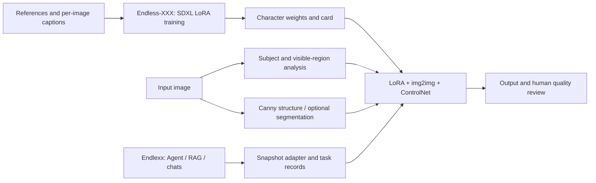

# Endlexx

[中文](README.md) · [English](README.en.md)

The main entry point for a character creation and visual transfer project, connecting a local agent workbench with Endless-XXX research. Organize conversations, reference profiles, knowledge and images by character, then use a planner to call retrieval, restoration, character transfer and visual consistency tools. Characters organize creative material; the assistant does not impersonate them.


## Project and research entry points

| Repository | Responsibility | Start here |
|---|---|---|
| **[Endlexx](https://github.com/ZerothXX/Endlexx)** | Main project, agent workbench, character knowledge/assets, tool orchestration and application evaluation | Workbench setup below |
| **[Endless-XXX](https://github.com/ZerothXX/Endless-XXX)** | Character LoRA training, visual transfer across open-domain subjects, research experiments and research UI | Its bilingual README for training/research |

The repositories remain separate. Endlexx presents the research and application together; Endless-XXX owns the training core. The application ships a hash-pinned inference snapshot. Linked documentation does not imply identical code versions.

## Research gallery: character features across subjects

These are **previously published historical input/output pairs** from Endless-XXX: **human1, jian1 and jian2**. The test character is March 7th from Honkai: Star Rail. These images were not generated by this Endlexx release and do not promise current output quality.

<table>
  <tr><th>Example</th><th>Input</th><th>Historical research output</th></tr>
  <tr><td>human1</td><td></td><td></td></tr>
  <tr><td>jian1</td><td></td><td></td></tr>
  <tr><td>jian2</td><td></td><td></td></tr>
</table>

Sources are pinned to research commit [`6bd78d4`](https://github.com/ZerothXX/Endless-XXX/tree/6bd78d48c4c99bef0be3ecf4f71e8536349c2acb). The images above link directly to the original files at that commit; original authors, individual licenses and complete generation settings were not recorded. See [results and limitations](docs/research/results.en.md) and the [asset manifest](docs/media/research/manifest.json) for further historical results, observations, SHA256 values for assets stored in this repository and reproduction requirements.

## Method and capability boundaries



| Capability | Research repository | Current Endlexx status |
|---|---|---|
| Character LoRA fine-tuning | Standard and 24GB configuration entries | Training UI/jobs are not integrated; run in the research repository |
| Character visual transfer | Separate person, animal and object strategies | Inference snapshot integrated; visual failures remain |
| Knowledge, chats, context and tool planning | Outside the training core | Implemented; does not require a sibling research checkout |
| General text-to-image / arbitrary package compatibility | Not established by example images | Not delivered as a verified capability; validate weights and package formats first |

The published [character LoRA](https://huggingface.co/ZerothX/endless-xxx-character-37-sdxl-lora) is a research resource, not a guarantee of compatibility with the application snapshot. See the [research overview](docs/research/overview.en.md) for responsibilities, versions and integration criteria.

## Features

| Capability | Implementation and scope |
|---|---|
| Characters and conversations | Multiple independent chats per character; isolated summaries, busy-chat protection and deletion that preserves character material and images |
| Agent workflow | LangGraph planning → tools → answer; schema validation, bounded retries, conditional execution, cancellation/recovery, frozen model snapshots and tool receipts |
| Context engineering | The model selects source IDs; code validates and copies excerpts, preserving recent turns and all original messages. Information outside the budget may still be omitted |
| Character RAG | TXT/Markdown/JSON import, Chinese BM25, BGE-M3, pgvector, RRF, BGE reranking, character/version filters and source citations |
| Local restoration | Conservative light/dark block-damage detection, VLM review, internal masks, LaMa and protected-region pixel validation |
| Character transfer (experimental) | Adapter for the formal Endless inference entry point, character packages, GPU lock and logs; current examples contain visible artifacts |
| Consistency checks (experimental) | Compare visible appearance with confirmed profiles; distinguish mismatch, unknown and not-visible, retaining independent review evidence |
| Models and environments | API connections, managed Ollama, a fixed research bundle, actual download progress, diagnostics and background jobs |
| Read-only MCP | Character listing and knowledge search over stdio; no arbitrary commands or image execution |

## Quick start on Windows

Extract the source archive and run from the directory containing `start.cmd`:

```powershell
.\start.cmd
# Prepare the application without starting services:
.\start.cmd --setup-only
```

Open **http://127.0.0.1:8765**. First launch requires network access and a writable project directory. The launcher prepares project-local Python, dependencies, Node and the frontend as needed; Docker and WSL are not required. Installing the system VC++ runtime may request administrator approval. This source archive includes neither runtimes nor weights and is not an offline portable distribution. See the [setup guide, Chinese](docs/环境自动配置.md).

A fresh installation starts empty: create a character → configure a connection in **模型** (Models) at the bottom left → open a character conversation. **The archive does not contain the development machine's connections, characters or chat history.** The workbench UI currently uses Chinese labels.

| Model route | Requirements |
|---|---|
| API controller | A Chat Completions-compatible URL, key, text model ID and vision model ID. Prompts/images go to that provider; image execution still needs local tools |
| Local visual controller | Deploy an Ollama vision model in model settings, or use native Qwen3-VL from the fixed bundle |
| Local text controller | Deploy a general Qwen3 model. The current installer requires the bundle's local Qwen3-VL for separate image routing |
| Image tool bundle | A compatible NVIDIA GPU/driver, substantial disk space and model downloads. Character transfer also requires a published character-specific LoRA package |

An API-only workbench does not require a local image GPU, but cannot execute restoration/transfer without the local tools. The development RTX 4060 Laptop 8GB uses Qwen3 8B for control and Qwen3-VL 4B for vision. Sequential loading/unloading saves VRAM at the cost of latency. New chats inherit the active connection; existing chats retain their choices.

Reuse a complete research installation through `ENDLEXX_ENDLESS_ROOT` and `ENDLEXX_LAMA_PATH`. Otherwise the bundle installer uses the inference snapshot in `vendor/endless/` and installs under this project's `data/`; it does not write into sibling research directories. General model downloads do not include character-specific weights.

## Usage, configuration and shutdown

- Click **新建对话** (New chat) under a character. Deleting a conversation removes its messages, summary, tasks and checkpoints. Cancel or finish running tasks first.
- Import knowledge through the top-right knowledge panel. Review and confirm a character profile before requesting consistency checks.
- Upload an image and describe the task. Conditional instructions such as “check first; modify only on a clear mismatch; stop if uncertain” record why an operation was skipped.
- Switch models below the composer. Manage connections/downloads in model settings. Logs are in `data/logs/`; task logs in `data/tasks/<task_id>/`.

```powershell
.\.venv\Scripts\python.exe scripts/stop.py
```

The stop script checks ownership of registered processes; insufficient permissions preserve the PID and return failure. Unavailable configured services never trigger a silent database switch. `start.cmd --lightweight` explicitly uses the separate `data/endlexx-local.db` workspace without migrating earlier chats. Do not run workers from two workspaces simultaneously.

SQLite plus the local task queue is the default. PostgreSQL/pgvector and Redis/Celery are optional development paths. `compose.yaml` runs infrastructure only; configure `POSTGRES_PASSWORD`, `REDIS_PASSWORD` and application connections yourself. Back up an existing database before `python -m alembic upgrade head`.

Configuration is documented in `.env.example`. `ENDLEXX_CONTEXT_HISTORY_BYTES` defaults to 3000 UTF-8 bytes. Never commit a real `.env` or `data/`. See [model management, Chinese](docs/模型管理.md).

## Development and tests

Validated with Python 3.12 and Node.js 22. Windows is the supported automatic-setup/image-bundle platform. Linux application CI does not establish cross-platform GPU deployment support.

```powershell
python -m venv .venv
.\.venv\Scripts\python.exe -m pip install -r requirements.lock
.\.venv\Scripts\python.exe -m pip install -e ".[dev]"
npm.cmd --prefix frontend ci
npm.cmd --prefix frontend run build
.\.venv\Scripts\python.exe -c "from scripts.bootstrap_app import initialize_config; initialize_config()"
.\start.cmd

.\.venv\Scripts\python.exe -m pytest -q
.\.venv\Scripts\python.exe -m ruff check endlexx scripts tests
# Before the first browser test run:
npm.cmd --prefix frontend exec -- playwright install chromium
$env:ENDLEXX_TEST_PYTHON = (Resolve-Path .\.venv\Scripts\python.exe).Path
npm.cmd --prefix frontend run test:e2e
```

Browser tests start an isolated API/database automatically. Set `ENDLEXX_TEST_BASE_URL` to use your own test service instead. GitHub Actions is configured for Windows/Linux application tests and browser checks. Local results are recorded separately from remote CI that has not yet run.

The same implementation produced these results on 30 development regression cases on 2026-10-25:

| Controller | Tool selection | Complex planning | Summary fidelity | Tool-selection P50 |
|---|---:|---:|---:|---:|
| Qwen3-VL 4B NF4 | 16/16 | 5/8 | 6/6 | 2.45 s |
| Qwen3 8B Q4_K_M | 15/16 | 7/8 | 6/6 | 6.33 s |

This small set was used during development, not held out as a general benchmark. Summary results include programmatic fidelity safeguards, not model memory alone. Actual-model acceptance covered knowledge answers, image chat, local restoration, long contexts and MCP. See the [quality report, Chinese](docs/Agent质量与改进验收.md) and the [release verification](docs/RELEASE.md).

Real-model evaluation requires separate weights, materials and an isolated database. Consult the report, `scripts/evaluate_agent.py --help` and `scripts/smoke_agent.py --help`. Ordinary CI does not download or run large models.

## Known limitations

- Transfer examples have color banding and edge artifacts and take about 13 minutes each. Execution success does not imply acceptable image quality.
- Consistency checks may return unknown for missing glasses; they are unsuitable for automatic quality decisions.
- Restoration is validated only on localized block damage. Legacy PPO checkpoints lack the encoder and are not enabled.
- Complex conditional planning and context selection can omit information. Original messages are retained; invalid plans request clarification.
- No real third-party API key was available; external providers received protocol/error-handling tests only.
- Local checkpoints and process locks do not provide tenant authorization, distributed scheduling or production operations. Do not expose the default configuration publicly.

## Layout and MCP

```text
frontend/             React + TypeScript + Vite
endlexx/              FastAPI, LangGraph, RAG, tools and material management
scripts/              Setup, inference adapters, evaluations, shutdown and packaging
tests/ / evals/       Boundary tests and model-evaluation fixtures
migrations/          Alembic migrations
vendor/endless/      Inference source and SHA256 inventory; no weights
docs/                Setup, models, acceptance, research overview and attributed media
```

For a trusted local MCP client, use the repository root as the working directory and run `.venv/Scripts/python.exe -m endlexx.mcp_server`. Tools: `list_characters` and `search_character_knowledge`. Explicitly pass the same `ENDLEXX_DATABASE_URL` used by the API; lightweight workspaces use `sqlite:///./data/endlexx-local.db`. The SDK does not automatically inherit arbitrary `ENDLEXX_` variables. First startup may initialize missing database tables.

## GitHub source archive and licensing

```powershell
.\.venv\Scripts\python.exe scripts/package_source.py
.\.venv\Scripts\python.exe scripts/package_source.py --verify dist/Endlexx-0.1.0-source.zip
```

Produces a ZIP, SHA256 checksum and per-file manifest. An allowlist includes source, documentation and registered research gallery images, excluding credentials, databases, user images, weights, caches, runtimes, legacy PPO training material and private requirement notes. Packaging also checks local publication links and gallery provenance hashes. Extract and commit the **contents** of `Endlexx-0.1.0/` to the repository root, including hidden `.github`, `.gitignore` and `.env.example`. The ZIP can also be a Release attachment.

See the [upload guide](docs/GITHUB_UPLOAD.md) for repository destinations, upload order and suggested GitHub About settings. This is a source preview without a selected project-wide license; do not label it MIT/Apache open source. Research code, dependencies and models have independent provenance/terms: [third-party notices](THIRD_PARTY_NOTICES.md). [Contributing](CONTRIBUTING.md) · [Security](SECURITY.md).

