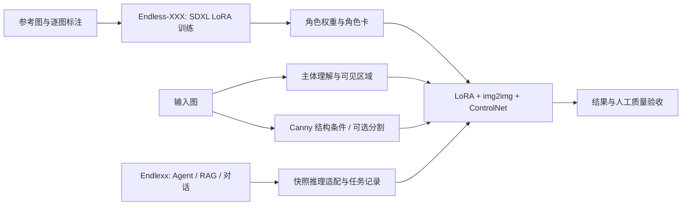

# Endlexx

[中文](README.md) · [English](README.en.md)

角色创作与视觉迁移项目的主入口，连接本机 Agent 工作台与 Endless-XXX 研究。按角色管理对话、设定、知识和图片，通过规划器调用检索、图像修复、角色迁移与视觉一致性检查工具。角色组织资料和资产，助手不扮演角色人格。


## 项目与研究入口

| 仓库 | 职责 | 从哪里开始 |
|---|---|---|
| **[Endlexx](https://github.com/ZerothXX/Endlexx)** | 主项目、Agent 工作台、角色知识与资产、工具编排和应用验收 | 使用工作台：见下方快速开始 |
| **[Endless-XXX](https://github.com/ZerothXX/Endless-XXX)** | 角色 LoRA 训练、开放域主体视觉迁移、研究实验与研究网页 | 训练和研究：见其双语 README |

两者保留独立仓库。Endlexx 展示研究与应用全貌；训练核心继续在 Endless-XXX 维护，应用随包提供经哈希固定的推理快照。文档关联不等于两个代码版本完全同步。

## 研究效果：角色特征迁移到开放域主体

以下是 Endless-XXX 已公开的**历史输入/输出**，涵盖人物、动物与物品。它们不是本次 Endlexx 的生成结果，也不是新版本效果承诺。

<table>
  <tr><th>主体</th><th>输入</th><th>历史研究输出</th></tr>
  <tr><td>人物</td><td></td><td></td></tr>
  <tr><td>动物</td><td></td><td></td></tr>
  <tr><td>物品</td><td></td><td></td></tr>
</table>

来源固定于研究仓库提交 [`6bd78d4`](https://github.com/ZerothXX/Endless-XXX/tree/6bd78d48c4c99bef0be3ecf4f71e8536349c2acb)，图片按原字节保存；原作者、单图许可和完整生成参数未记录。可见效果与待解决问题、文件 SHA256 和复现要求见 [研究结果与局限](docs/research/results.md) / [素材清单](docs/media/research/manifest.json)。

## 方法与能力边界



| 能力 | 研究仓库 | Endlexx 当前状态 |
|---|---|---|
| 角色 LoRA 微调 | 标准入口及 24GB 参数入口 | 未集成训练 UI/训练任务；在研究仓库执行 |
| 角色视觉迁移 | 人物、动物、物品差异策略 | 已接入推理快照，画质仍有失败项 |
| 角色知识、对话、上下文与工具规划 | 非研究训练核心 | 已实现，独立于同级研究目录运行 |
| 通用文生图 / 任意角色包直接兼容 | 不由展示图证明 | 未作为已交付能力；权重及角色包格式须先验证 |

公开的 [角色 LoRA 权重](https://huggingface.co/ZerothX/endless-xxx-character-37-sdxl-lora) 是研究资源入口；不保证与应用快照直接兼容。实现分工、版本与后续集成标准见 [研究概览](docs/research/overview.md)。

## 功能

| 能力 | 实现与边界 |
|---|---|
| 角色与多对话 | 同角色新建/删除独立对话，摘要隔离、忙碌保护、删除时保留角色资料与图片 |
| Agent 工作流 | LangGraph 规划 → 工具 → 回答；结构校验、有界重试、条件执行、取消/恢复、模型快照和工具回执 |
| 上下文工程 | 模型选择原文编号，程序校验后摘录；保留近期交流和全部原始消息，预算外信息仍可能漏选 |
| 角色 RAG | TXT/Markdown/JSON 导入，中文 BM25、BGE-M3、pgvector、RRF、BGE 重排、角色/版本过滤与原文引用 |
| 自动局部修复 | 保守定位浅色/深色色块缺损，VLM 判断、内部蒙版、LaMa 与保护区像素校验 |
| 角色迁移（实验） | Endless 正式推理入口、角色包、GPU 锁与日志；当前样例存在明显伪影 |
| 一致性检查（实验） | 已确认档案与可见外观对比，区分不符/未知/不可见，保留独立复核记录 |
| 模型与环境 | API 连接、Ollama 部署、固定研究组合、真实下载进度、诊断与后台任务 |
| 只读 MCP | stdio 角色列表和知识检索，不暴露任意命令或图像执行 |

## 快速开始（Windows）

解压源码包，在含有 `start.cmd` 的目录执行：

```powershell
.\start.cmd
# 只准备应用环境，不启动服务：
.\start.cmd --setup-only
```

打开 **http://127.0.0.1:8765**。首次启动需要网络与目录写入权限，按需准备项目专用 Python、依赖、Node 和前端；无需预装 Docker/WSL。系统 VC++ 运行库可能请求管理员授权。源码包不含运行时或权重，不是离线便携包。详见 [环境自动配置](docs/环境自动配置.md)。

首次启动是空工作空间：新建角色 → 左下「模型」配置连接 → 进入角色对话。**源码包不预置开发机器的模型连接、角色或聊天记录。**

| 模型路径 | 需要准备什么 |
|---|---|
| API 主控 | 兼容 Chat Completions 的 URL、Key、文字/视觉模型 ID。提示与图片发送给该服务；图像执行仍需本地工具 |
| 本地视觉主控 | 在模型设置部署 Ollama 视觉模型，或使用固定组合中的原生 Qwen3-VL |
| 本地文字主控 | 可部署 Qwen3 通用模型；当前安装器要求已有组合中的本地 Qwen3-VL，图片独立交给它 |
| 图像工具组合 | 兼容 NVIDIA GPU/驱动、较大磁盘空间和权重下载；角色迁移另需已发布的角色 LoRA 包 |

纯 API 工作台不要求本地图像 GPU；未部署本地工具时不能执行图像修复/迁移。开发机器 RTX 4060 Laptop 8GB 使用 Qwen3 8B 主控、Qwen3-VL 4B 看图；顺序加载/卸载控制显存，但增加延迟。新对话继承启用的模型，旧对话保留原选择。

已有研究安装可通过 `ENDLEXX_ENDLESS_ROOT` 和 `ENDLEXX_LAMA_PATH` 复用；否则组合安装器使用 `vendor/endless/` 推理快照，在项目 `data/` 下安装，不向同级研究目录写入。模型不包含角色专属权重。

## 使用、配置与停止

- 侧栏角色下「新建对话」；删除会话时清理其消息、摘要、任务与检查点。执行中的任务需先取消或等待。
- 右上知识库导入资料；编辑并核实角色档案，再请求一致性检查。
- 上传图片后输入需求。支持「先检查，仅明确不符时修改；无法判断就停止」，跳过操作会记录原因。
- 输入框下方切换模型，模型设置管理连接与下载。日志位于 `data/logs/`，任务日志位于 `data/tasks/<task_id>/`。

```powershell
.\.venv\Scripts\python.exe scripts/stop.py
```

停止脚本核验登记进程的项目归属；权限不足时保留 PID、返回失败。现有服务不可用时不会静默换库。`start.cmd --lightweight` 明确使用独立的 `data/endlexx-local.db`，不搬迁旧聊天记录；勿同时运行两个工作空间的 Worker。

默认 SQLite + 本地队列；PostgreSQL/pgvector 与 Redis/Celery 为可选开发路径。`compose.yaml` 只承载基础服务，需设置 `POSTGRES_PASSWORD`、`REDIS_PASSWORD` 与应用连接。已有数据库先备份，再执行 `python -m alembic upgrade head`。

`.env.example` 列出配置；历史预算 `ENDLEXX_CONTEXT_HISTORY_BYTES` 默认为 3000 UTF-8 字节。勿提交真实 `.env` 和 `data/`。详见 [模型管理](docs/模型管理.md)。

## 开发与测试

已验证 Python 3.12、Node.js 22。Windows 是自动安装和图像组合的支持平台；Linux CI 不代表跨平台 GPU 部署已交付。

```powershell
python -m venv .venv
.\.venv\Scripts\python.exe -m pip install -r requirements.lock
.\.venv\Scripts\python.exe -m pip install -e ".[dev]"
npm.cmd --prefix frontend ci
npm.cmd --prefix frontend run build
.\.venv\Scripts\python.exe -c "from scripts.bootstrap_app import initialize_config; initialize_config()"
.\start.cmd

.\.venv\Scripts\python.exe -m pytest -q
.\.venv\Scripts\python.exe -m ruff check endlexx scripts tests
# 首次浏览器测试前：
npm.cmd --prefix frontend exec -- playwright install chromium
$env:ENDLEXX_TEST_PYTHON = (Resolve-Path .\.venv\Scripts\python.exe).Path
npm.cmd --prefix frontend run test:e2e
```

浏览器测试默认自动启动隔离 API/数据库；设置 `ENDLEXX_TEST_BASE_URL` 可连接自备测试服务。GitHub Actions 配置覆盖 Windows/Linux 应用测试及浏览器流程，本地结果与尚未执行的远程 CI 状态分开记录。

2026-10-25，同一实现的 30 项开发回归用例：

| 主控 | 工具选择 | 复杂规划 | 摘要保真 | 工具选择 P50 |
|---|---:|---:|---:|---:|
| Qwen3-VL 4B NF4 | 16/16 | 5/8 | 6/6 | 2.45 秒 |
| Qwen3 8B Q4_K_M | 15/16 | 7/8 | 6/6 | 6.33 秒 |

这是参与迭代的小样本，非独立通用基准；摘要成绩包含程序护栏，不能归因于模型记忆。真实验收已覆盖知识问答、图片问答、局部修复、长对话及 MCP。方法与失败项见 [Agent 质量报告](docs/Agent质量与改进验收.md)，本次发布检查见 [发布验收](docs/RELEASE.md)。

真实模型评测需另行准备权重、资料与隔离数据库，见报告及 `scripts/evaluate_agent.py --help`、`scripts/smoke_agent.py --help`；普通 CI 不下载或推理大模型。

## 已知限制

- 角色迁移存在色带和边缘伪影，单样例约 13 分钟；执行完成不等于画质达标。
- 一致性检查对缺失眼镜仍可能返回 unknown，不适合自动质量裁决。
- 自动修复仅验证局部色块缺损；PPO 旧检查点缺少编码器，未启用。
- 复杂条件规划与预算外摘要仍可能遗漏；保留原始消息，校验失败请求澄清。
- 无真实第三方 API 密钥，外部服务仅完成协议/异常测试。
- 单机检查点与进程锁不能替代多租户授权、分布式调度和生产运维，不直接暴露公网。

## 结构与 MCP

```text
frontend/             React + TypeScript + Vite
endlexx/              FastAPI、LangGraph、RAG、工具与资料管理
scripts/              安装、推理适配、评测、停止与源码打包
tests/ / evals/       边界测试与模型评测用例
migrations/          Alembic 迁移
vendor/endless/      推理源码及 SHA256 清单，不含权重
docs/                安装、模型、验收、研究概览与有来源的展示素材
```

MCP 客户端以仓库根目录为工作目录，运行 `.venv/Scripts/python.exe -m endlexx.mcp_server`，提供 `list_characters`、`search_character_knowledge`。仅供可信本机客户端；需显式传入与 API 相同的 `ENDLEXX_DATABASE_URL`，轻量空间为 `sqlite:///./data/endlexx-local.db`。SDK 不自动继承任意 `ENDLEXX_` 变量，首次启动可能初始化数据库表。

## GitHub 源码包与许可证

```powershell
.\.venv\Scripts\python.exe scripts/package_source.py
.\.venv\Scripts\python.exe scripts/package_source.py --verify dist/Endlexx-0.1.0-source.zip
```

产出 ZIP、SHA256 文件和包内逐文件清单。白名单仅包含源码、文档和已登记的研究展示图，排除凭据、数据库、用户图片、权重、缓存、运行时、PPO 训练材料与私人需求笔记。打包时同时检查公开文档的本地链接及展示图来源哈希。解压后将 `Endlexx-0.1.0/` **目录内的文件**提交到仓库根目录，保留隐藏的 `.github`、`.gitignore`、`.env.example`；ZIP 也可作 Release 附件。

两个仓库的上传顺序、文件落点和 GitHub About 建议见 [上传说明](docs/GITHUB_UPLOAD.md)。目前是未指定项目级许可证的源码预览，不标注为 MIT/Apache 开源。研究代码、依赖和模型的来源/条款独立，见 [第三方说明](THIRD_PARTY_NOTICES.md)。[参与开发](CONTRIBUTING.md) · [安全边界](SECURITY.md)。

